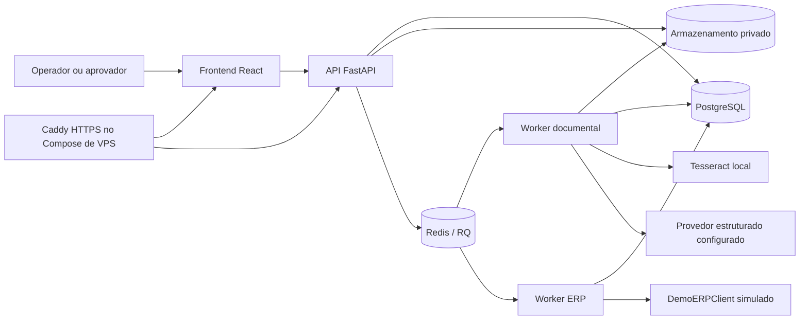

# DocuFlow

**Conferência de documentos comerciais com extração de dados, regras determinísticas e revisão humana.**

> Aplicação demonstrativa. Os documentos e cadastros de exemplo são fictícios; não use este projeto como sistema fiscal ou contábil certificado.

## Problema e público

DocuFlow demonstra como equipes de contas a pagar e operações podem conferir documentos de fornecedores contra pedidos de compra, mantendo evidências, regras comerciais e decisões humanas visíveis. A aplicação é voltada a demonstrações técnicas e aprendizado, não a processamento financeiro autônomo.

## Fluxo

1. Uma pessoa envia PDF, PNG ou JPEG e seleciona um pedido.
2. A API persiste o arquivo privado e enfileira o processamento.
3. O worker extrai texto nativo ou aplica OCR local às páginas necessárias; o provedor estruturado devolve campos com página e evidência.
4. O backend confere evidências e executa validações comerciais determinísticas.
5. Um operador revisa ou corrige os dados; um aprovador decide explicitamente.
6. Depois da aprovação, um aprovador pode solicitar o envio à integração ERP simulada.

## Funcionalidades implementadas

- Login, papéis `operator` e `approver`, workspaces e isolamento de dados.
- Upload privado, processamento assíncrono Redis/RQ, extração de PDF e OCR local para páginas/imagens.
- Evidências por página, validação comercial com `Decimal`, políticas versionadas por workspace e histórico imutável de revisão/aprovação.
- Atribuição de responsáveis, importação de pedidos por CSV, painel operacional e auditoria.
- Interface React responsiva, recuperação de jobs e envio explícito ao ERP de demonstração.
- Compose de desenvolvimento e configuração independente para um piloto de VPS.

Contratos, permissões, estados, limites e endpoints estão em [funcionalidades e contratos](docs/funcionalidades.md).

**Estrutura atual:** `backend/app/` contém API, serviços, integrações, modelos, repositórios e schemas; `backend/migrations/` mantém Alembic; `backend/tests/` reúne suítes unitárias e de integração; `frontend/src/` contém o React; `docs/` guarda referências e guias; `samples/` separa entradas fictícias e ground truth.

## Arquitetura



## Início rápido local

Pré-requisitos para a stack em containers: Docker Engine com Docker Compose v2, `openssl`, navegador moderno e um Ollama local acessível pelo worker se quiser executar a extração estruturada. Quando necessário, inicie o Ollama e disponibilize o modelo configurado (por exemplo, `ollama pull <modelo>`). O worker de documentos inclui Tesseract e os idiomas `por` e `eng`. Para executar ferramentas/testes no host, consulte [desenvolvimento local](docs/desenvolvimento-local.md).

1. Crie `.env` privado apenas se ainda não existir. Não substitua um arquivo existente. Edite-o localmente e configure `POSTGRES_PASSWORD`, as URLs de banco (`DATABASE_URL`, `TEST_DATABASE_URL` e `DOCUFLOW_CONTAINER_DATABASE_URL`) com a mesma credencial, e `JWT_SECRET_KEY` com um valor gerado por `openssl rand -hex 32`. Mantenha credenciais fora do Git; `.env.example` contém valores ilustrativos. Para o Compose local, `DOCUFLOW_OLLAMA_BASE_URL` usa `host.docker.internal`; não use esse endereço no piloto VPS. Ollama e o modelo configurado são instalados separadamente.

   ```bash
   if [ ! -f .env ]; then cp .env.example .env; fi
   ```

2. Valide e construa as imagens; inicie os serviços de dados; aplique migrações e seed explicitamente:

   ```bash
   docker compose config --quiet
   docker compose build api document-worker erp-worker frontend
   docker compose up -d --wait postgres redis
   docker compose run --rm --no-deps api alembic -c backend/alembic.ini upgrade head
   docker compose run --rm --no-deps api python -m backend.app.seed_reference_order
   ```

3. Crie o primeiro usuário com senha oculta no prompt. O exemplo de demonstração concede os dois papéis; use os papéis mínimos necessários em outros ambientes.

   ```bash
   docker compose run --rm --no-deps api python -m backend.app.admin create-user \
     --email operador@example.test --workspace demo --role operator --role approver
   ```

4. Inicie API, workers e frontend; abra a interface em `http://localhost:5173`.

   ```bash
   docker compose up -d --wait api document-worker erp-worker frontend
   docker compose ps
   ```

A stack executa API em `http://localhost:8000`; as portas locais ficam vinculadas a loopback. A API não aplica migrações automaticamente. Para comandos no host, Tesseract, Ollama, testes, recuperação e detalhes de configuração, veja [desenvolvimento local](docs/desenvolvimento-local.md).

## Documentos de demonstração

Os dez arquivos reproduzíveis, o pedido associado e a separação entre verdade do documento e expectativa comercial estão em [samples/README.md](samples/README.md). Comece com `01_correto.pdf`; compare com os casos de preço, total, quantidade e fornecedor divergentes. `08_correto_digitalizado.pdf` e `09_correto_foto.png` exercitam OCR. `10_duplicata_exata.pdf` tem os mesmos bytes do caso 01 e demonstra detecção de repetição no mesmo workspace. Associe todos ao pedido fictício `PC-2026-0001`.

`samples/ground_truth/manifest.json` é o gabarito para avaliação e não deve ser enviado ao provedor de extração. Os PDFs e a imagem contêm apenas dados inventados e aviso de uso demonstrativo.

A avaliação manual da extração real, incluindo comando, métricas e limitações, está em [avaliação de extração](docs/avaliacao-extracao.md). Ela usa somente Ollama local e não participa da suíte normal de CI.

## Testes e automação

As instruções para testes unitários, frontend, PostgreSQL/Redis, OCR opcional e Playwright estão em [testes e validação](docs/testes.md). O workflow configurado pode ser acompanhado em [GitHub Actions](https://github.com/mateuscardososs/DocuFlow/actions); não há resultados de execução declarados nesta página.

## Limitações e próximos passos

O fluxo da aplicação e suas integrações simuladas estão implementados e cobertos por testes unitários, de integração e Playwright conforme as dependências de cada suíte. Validação manual com usuários e implantação pública em VPS não estão registradas como concluídas.

- `DemoERPClient` apenas simula o cadastro e retorna um identificador fictício. Não há emissão fiscal, RPA de ERP externo ou reconciliação após lançamento em sistema externo.
- Playwright testa os fluxos da aplicação com provedor estruturado determinístico e adaptador ERP simulado; isso não testa ERP real nem mede a qualidade de um modelo.
- A avaliação com modelo real é manual e usa Ollama local; os relatórios de cada execução ficam em `var/evaluations/`, ignorado pelo Git. A amostra sintética não representa desempenho geral. O manifesto é um gabarito, não resultado de inferência.
- OCR pode errar; evidência confirma presença de texto na página, não a correção do valor. Revisão e aprovação não são automáticas.
- O Compose de VPS e sua validação de configuração não equivalem a implantação pública validada. Domínio, hospedagem, DNS, TLS real, segredos e restauração ainda dependem de validação no ambiente escolhido. Consulte [implantação em VPS](docs/implantacao-vps.md) e [backup/restauração](docs/backup-restauracao.md).

Próximas validações: ampliar a avaliação manual em amostras sintéticas conforme necessário, conduzir validação com usuários e testar o piloto no domínio e provedor de hospedagem escolhidos. Qualquer integração ou reconciliação com ERP externo exige escopo separado.
